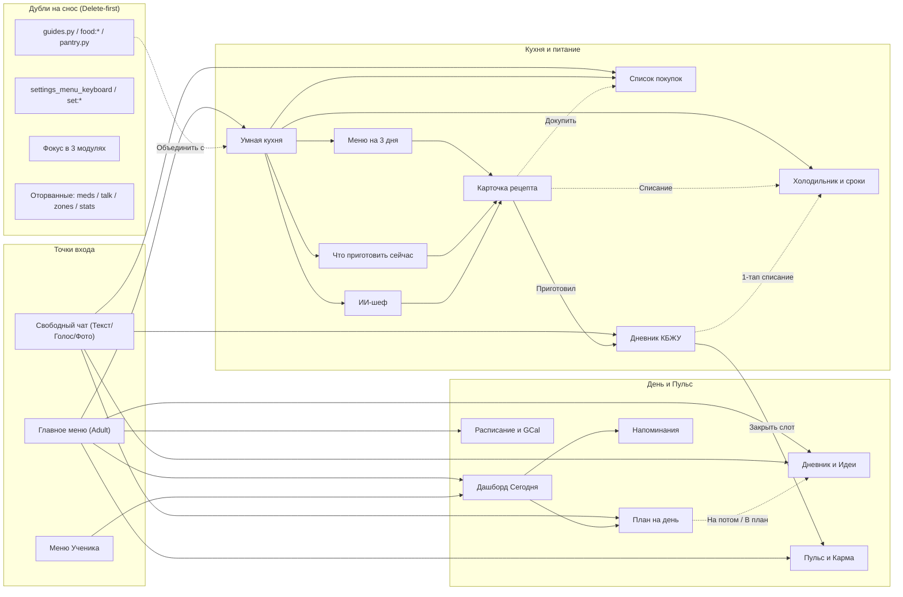

# HiDL — OOUX Object Map, Breadboard & Design Contracts

> Единый источник правды по сущностям, связям, экранам, каналам входа и правилам интеграции фич (процесс **OOUX -> Breadboard -> Код**).
>
> **Интерактивная схема в FigJam:** [HiDL Object and Screen Breadboard](https://www.figma.com/board/FZwitiGcxWfvKUiqwsv8Ch?utm_source=other&utm_content=edit_in_figjam&oai_id=&request_id=16b958c7-c264-49c4-8bab-e962425581f6)

---

## 1. OOUX / ORCA Map (Сущности, таблицы и связи)

В основе HiDL — 15 пользовательских сущностей поверх 57 таблиц SQLite ([db/database.py](../db/database.py)).

| # | Сущность | Таблицы SQLite | Область владения (`scope` / права) | Ключевые связи (`Relationships`) | Модули-владельцы |
|---|---|---|---|---|---|
| 1 | **Пользователь и профиль** | `users`, `wellness_settings`, `user_profile_memory` | Personal (`user_id`, удаляется полностью) | Задаёт режим (`adult` / `student`), КБЖУ-цель, `meal_profile`, таймзону, сон | `handlers/start.py`, `handlers/settings.py`, `middlewares/ensure_user.py` |
| 2 | **План дня (Задачи)** | `day_plans`, `day_plan_items`, `inbox_actions` | Personal (`user_id`) | Переносится (`sync_overdue`), откладывается в **Идеи**, синхронизируется с **Сегодня** | `handlers/day_plan.py`, `services/inbox_service.py`, `utils/today.py` |
| 3 | **Идея / Бэклог / Дневник** | `journal_entries`, `inbox_messages`, `inbox_actions` | Personal (`user_id`) | Извлекается из свободного чата/голоса; `idea` <-> `day_plan_items` | `handlers/inbox.py`, `services/inbox_parser.py`, `services/inbox_service.py` |
| 4 | **Холодильник (Кладовка)** | `pantry_items`, `receipt_photos` | Shared by `household_id` (или `user_id`) | Питает **Рецепт** и **Меню**, списывается из **КБЖУ**, пополняется из **Покупок** / чеков | `handlers/kitchen.py`, `services/kitchen_ai.py`, `services/inbox_service.py` |
| 5 | **Список покупок** | `shopping_list` | `household` / `personal` | Заполняется из рецептов («не хватает»), чата и авто-режима; убранное может уйти в кладовку | `handlers/kitchen.py`, `services/kitchen_ai.py` |
| 6 | **Рецепт** | `user_recipes` + встроенная база (`research_data.py` / сиды) | Personal / Household (`share_recipes`) | Читает `pantry_items`, при «Приготовил» создаёт `meal_logs`, списывает кладовку, закрывает **Пульс** | `handlers/kitchen.py`, `services/kitchen_ai.py`, `handlers/nutrition.py` |
| 7 | **Меню на 3 дня** | `meal_plans` | Personal / Household | Ссылается на `recipe_id` и `meal_slot` (`breakfast`/`lunch`/`dinner`), открывается на верху `🍽 Еда и покупки` | `handlers/kitchen.py`, `services/kitchen_ai.py` |
| 8 | **Дневник КБЖУ и этикетки** | `meal_logs`, `pending_meal_clarifications`, `user_food_products`, `nutrition_lookup_cache` | Strictly Personal (`user_id`) | Создаётся из текста/голоса/фото/рецепта; 1-тап списывает `pantry_items` и закрывает пищевой **Пульс** | `handlers/nutrition.py`, `handlers/inbox.py`, `services/fitness_nutrition.py`, `services/nutrition_web.py` |
| 9 | **Пульс дня и Карма** | `pulse_checkins`, `user_karma_state`, `karma_events` | Personal (`user_id`) | Слоты `wake`/`lunch`/`dinner`/`water`/`bedtime` закрываются кнопками, едой или сном | `handlers/pulse.py`, `services/pulse_service.py`, `services/karma_service.py` |
| 10 | **Напоминания (Разовые / Лекарства)** | `custom_reminders`, `custom_tasks`, `meds`, `med_logs` | Personal (`user_id`) | Показываются в `/today`, управляются из чата и планировщика | `handlers/custom_reminders.py`, `handlers/meds.py`, `scheduler/reminder.py` |
| 11 | **Расписание и Календарь** | `schedule_blocks`, `schedule_events`, `calendar_events`, `user_calendar_connections`, `gcal_oauth_states` | Personal (`user_id`) | Двусторонний sync с Google Calendar, алерты, блок на **Сегодня** | `handlers/schedule.py`, `services/calendar_service.py` |
| 12 | **Тело, Весы и Спорт** | `weights`, `workout_logs`, `focus_sessions` | Strictly Personal (`user_id`) | Влияют на суточную норму КБЖУ (`calculate_daily_targets`), закрывают тренировочные цели | `handlers/movement.py`, `handlers/focus_cafe.py`, `services/fitness_nutrition.py` |
| 13 | **Наш дом и Регулярные дела** | `households`, `household_requests`, `household_dinner_polls`, `regular_tasks`, `cleaning_sessions`, `supplies`, `routines`, `user_routines`, `routine_items`, `routine_steps` | Household (`household_id`, настройки в `households.settings`) | Партнёрские просьбы, голосование за ужин, зоны уборки, бытовая химия, рутины | `handlers/household.py`, `handlers/home_tasks.py`, `handlers/home_supplies.py`, `handlers/routines.py` |
| 14 | **Финансы и Счета** | `budgets`, `budget_categories`, `expenses`, `bills`, `points_log` | Personal / Household (`share_bills`) | Траты из чата или кнопок, напоминания по счетам на **Сегодня** | `handlers/finance.py`, `handlers/stats.py` |
| 15 | **Интеграции (Desk / MCP)** | `desk_links`, `desk_link_tokens`, `desk_events`, `desk_outbox`, `mcp_*` | Personal (`user_id`) | Учёба/дэдлайны в режиме `student`, внешние ИИ-клиенты через OAuth/Bearer | `handlers/desk.py`, `handlers/mcp_connect.py`, `mcp_server/app.py` |

### Инварианты архитектуры
1. **Приватность здоровья и дневника:** `meal_logs`, `weights`, `workout_logs`, `journal_entries`, `user_karma_state` строго личные (`user_id`), никогда не утекают партнёру по дому.
2. **Единая кухня (`adult` vs `student`):** в режиме `student` скрыты бытовые/кухонные/финансовые разделы (`EnsureUserMiddleware._student_blocked`), вместо них выводится `📚 Учёба / Desk`.
3. **Связка `Холодильник <-> Рецепт <-> Меню <-> КБЖУ`:** рецепт и план на день обязаны учитывать реальные остатки `pantry_items`, честно показывать недостающее и после готовки списывать реальные продукты.

---

## 2. Матрица жизненного цикла (`Сущности x CRUD x Каналы x Роли`)

| Сущность | Создать | Открыть | Изменить / Адаптировать | Закрыть / Списать / Отложить | Поделиться (`household`) | Удалить | Каналы входа | Режим `student` | Подтверждённые дыры в UI/логике |
|---|---|---|---|---|---|---|---|---|---|
| **План дня (`day_plan_items`)** | Да (кнопка `+`, текст, голос) | Да (`/today`, `dplan:list`) | **Нет Rename в UI** (только важность/дата) | Да (Done, `⏳ На потом` в бэклог) | Нет (личное) | Да (`dplan:del`) | Кнопки, чат, голос, MCP | Разрешено | Нет переименования в UI; частичное выполнение (`done: половину разобрал`) не комментирует задачу |
| **Идея / Дневник (`journal_entries`)** | Да (текст, голос) | Да (`/diary`, `diary:ideas`) | Через `inbox:item` частично | Да («В план сегодня») | Нет (личное) | Да (`diary:del`, Undo) | Чат, голос, кнопка, MCP | Разрешено | Нет прямого редактирования текста идеи в UI |
| **Холодильник (`pantry_items`)** | Да (кнопка, bulk, чек, голос) | Да (`kitchen:fridge`, `/pantry`) | Частично (qty при списании / bulk) | Да (частичное списание `pantry_remove`, кнопка списания в КБЖУ) | Да (общий по `household_id`) | Да (`kitchen:fridge_del`) | Кнопки, чат, голос, фото чека, MCP | Скрыто | Нужен удобный inline-edit срока годности/количества одной позиции без bulk |
| **Покупки (`shopping_list`)** | Да (кнопка, чат, «не хватает в рецепте») | Да (`kitchen:shoplist`) | Отметка «куплено» (`toggle`) | Да (`shop_finish` -> перенос в кладовку) | Да (`household` / `personal`) | Да (`shop_del`, чат `shopping_remove`) | Кнопки, чат, голос, MCP | Скрыто | Проверить удаление устаревших ручных команд `/shoplist` (`guides.py`) |
| **Рецепт (`user_recipes`)** | Да (ИИ-шеф save, импорт PDF/текста) | Да (`kitchen:recipes`, `cook_view`) | Разовая адаптация под холодильник (`kitchen:adapt` без мутации `user_recipes`); **GAP: нет прямого Edit в UI** | Да (`cook_done` / `cook_and_log` / `cook_and_log_ad` -> КБЖУ + кладовка) | Да (`share_recipes`) | **GAP: нет Delete в UI** | Кнопки, PDF/текст, MCP | Скрыто | Разовая адаптация 1–3 продуктов работает без перезаписи рецепта; остаётся ручной Edit/Delete для `user_recipes` |
| **Меню на 3 дня (`meal_plans`)** | Да (`kitchen:meal_plan` авто-сборка с приоритетом «всё дома + истекает» на День 0) | Да (`Еда и покупки` сверху + `Меню на 3 дня`, `is_stale`-баннер и `⚠️ нет N прод.`) | **GAP: нельзя поменять 1 слот** | Да (`status = cooked`) | Да (`household_id`) | **GAP: нет сброса отдельного дня** | Кнопки | Скрыто | Закрыт GAP по устаревшим планам и приоритету холодильника на День 0; остаётся ручная замена/сброс отдельного слота |
| **КБЖУ (`meal_logs`)** | Да (текст, голос, фото, рецепт, MCP) | Да (`/kbju`, `kbju:today`) | Да (`kbju:refine`, ответ на уточнение) | Да (автокоммит через 10 мин, 1-тап списание кладовки) | Никогда | Да (`kbju:del`, Undo) | Текст, голос, фото, альбом, кнопки, MCP | Скрыто | — |
| **Личные этикетки (`user_food_products`)** | Авто-сохранение с фото/текста | **GAP: нет экрана просмотра** | Перезапись по ключу | Переиспользуется при разборе | Никогда | **GAP: нет удаления в UI** | Фото, текст `на 100 г` | Скрыто | Пользователь не видит и не может удалить ошибочно запомненную этикетку |
| **Пульс и Карма** | Авто-создание по расписанию | Да (`🌙 Сон и карма`, `/karma`) | Настройка времени/паузы | Да (кнопки, еда, сон, ЧП 24ч) | Нет | Пауза / сброс сном | Кнопки, пуши, чат | Еда-слоты скрыты | — |
| **Напоминания (`custom_reminders`)** | Да (`/add_reminder`, чат, голос) | Да (`/reminders`, `/today`) | Да (`customedit:`) | Да (`done`, `later`) | Нет | Да (`customdel:`) | Кнопки, чат, голос | Разрешено | — |
| **Календарь (`schedule_events`)** | Да (`/schedule`, чат -> GCal) | Да (`🗓 Расписание`, `/today`) | Частично | Событие проходит / перенос | Нет | Да (`cal:del`) | Кнопки, чат, голос, GCal, MCP | Разрешено | — |
| **Весы и Спорт (`weights`, `workout_logs`)** | Да (текст, фото Xiaomi, кнопки) | Да (`⚖ Тело и весы`, `🏋️ Спорт`) | Да (merge 2-го скрина весов) | Да (тренировки в карму + бонус КБЖУ) | Никогда | Базовое удаление/undo для inbox | Кнопки, чат, фото/файл, MCP | Весы/спорт по профилю | — |
| **Наш дом / Регулярки / Химия** | Да (`🏠 Наш дом`, `🧹 Дом`) | Да (`hh:hub`, `more:home`) | Да | Да (просьба принять/отложить/готово; уборка) | Да (`household_id`) | Да | Кнопки, пуши, чат | Скрыто | `zones.py` и `meds.py` оторваны от основного меню |
| **Финансы (`expenses`, `bills`)** | Да (кнопка, чат `потратил ...`) | Да (`more:money`, `/finance`) | Лимиты категорий | Да (оплата счёта) | Счета `share_bills` | Да (`money:history`) | Кнопки, чат, голос, MCP | Скрыто | Legacy `stats.py` дублирует отчётность |

---

## 3. Breadboard (Карта экранов и переходов)

### Точки входа (`ReplyKeyboard` + свободный чат)

| Точка входа | Целевой экран / модуль | Основные контролы внутри | Куда ведёт `Назад` | Владелец |
|---|---|---|---|---|
| `📅 Сегодня` / `/today` | Дашборд дня (`render_today`) | Рутины ✅/⏭, напоминания, фокус, быстрый чекин | `main:menu` | `handlers/menu.py`, `utils/today.py` |
| `🍽 Еда и покупки` / `/kitchen` | Умная кухня (`build_kitchen_home_payload`) | Текущее блюдо дня, `Что приготовить`, `Не хватает 1-2`, `ИИ-шеф`, `Мой КБЖУ`, `Меню на 3 дня`, `Холодильник`, `Покупки`, `Рецепты` | `kitchen:main` -> `main:menu` | `handlers/kitchen.py` |
| `🌙 Сон и карма` / `/pulse` | Пульс и карма | Статус слотов, долг/стрик, режим сна, перенос отбоя | `main:menu` | `handlers/pulse.py`, `handlers/sleep_mode.py` |
| `🗓 Расписание` / `/schedule` | Расписание и GCal | События сегодня/недели, подключение Google Calendar | `main:menu` | `handlers/schedule.py` |
| `📓 Дневник` / `/diary` | Дневник и Идеи | Записи дневника, список Идей, перенос идеи в План дня | `main:menu` | `handlers/inbox.py`, `handlers/day_plan.py` |
| `⚙ Ещё` | `more_menu_keyboard()` | `Наш дом`, `Дом`, `План на день`, `Напоминания`, `Деньги`, `Спорт`, `Кафе фокуса`, `Болею/ЧП`, `Настройки`, `Фидбек`, `Помощь сейчас` | `main:menu` | `keyboards/common.py`, `handlers/menu.py` |
| `Свободный чат` (текст / голос / фото / файл) | Единый Inbox-роутер | Классификация (`task`, `idea`, `diary`, `meal_log`, `pantry_*`, `shopping*`, `reminder`, `calendar_event`, `expense`, `weight_log`, `workout_log`, `query`), альбомы `kbju:confirm:<pid>`, `Исправить`, `Отменить всё` | — | `handlers/inbox.py`, `handlers/natural.py`, `services/inbox_service.py` |
| `Student Menu` (`is_student_mode`) | Учёба / Desk + фокус + сон | `Сегодня`, `Учёба / Desk`, `Напоминания`, `Кафе фокуса`, `Сон и пауза`, `Настройки` | `main:menu` | `keyboards/common.py`, `middlewares/ensure_user.py` |

### Схема потоков (Mermaid)

---

## 4. Delete-First реестр (что унифицировать и удалить при следующих релизах)

1. **`handlers/guides.py` + `handlers/menu.py` (`food:*`) + `handlers/pantry.py`:** старые статичные меню (`/meal_plan`, `/recipes_fast`, `/shoplist`, `/plate`, `/cook_from_expiring`) и обёртка `food:pantry` дублируют живую `handlers/kitchen.py`. При касании раздела — вырезать статичные дубли и свести команды к `kitchen.py`.
2. **`keyboards/common.py:settings_menu_keyboard()` + `handlers/menu.py` (`set:*`):** дубликат `handlers/settings.py` (`settings:*`). Оставить единый экран `settings.py`.
3. **Фокус-таймер в 3 местах:** `handlers/focus_cafe.py`, `handlers/movement.py` (`move:focus`), `handlers/wellness.py` (`/focus`). Оставить один вход (`focus_cafe.py`) и проксировать из кнопок туда.
4. **Пауза и щадящий режим в 3 местах:** `handlers/pause.py`, `handlers/wellness.py` (`/gentle`, `/resume`), `handlers/settings.py`. Свести в единый модуль.
5. **Оторванные / заглушечные модули:** `handlers/talk.py` (16 строк, заглушка — поглотить через `/help` и `inbox`), `handlers/zones.py` (28 строк — перенести внутрь `home_tasks.py`), `handlers/meds.py` (нет кнопки ни в `more_menu_keyboard`, ни в `settings` — либо привязать в меню, либо убрать из видимых команд), `handlers/stats.py` (`points_log` — наследие до Кармы).

---

## 5. Мини-контракт следующей фичи: «Умная адаптация рецепта под холодильник + свежесть меню»

> **Статус:** **Реализовано (2026-11-27)** — `services/kitchen_ai.py` (`adapt_recipe_to_pantry`, приоритет Дня 0 в `generate_meal_plan`, `is_stale` / `missing_count` в `get_meal_plan_view`, `recipe_override` в `commit_cooked_recipe`), `handlers/kitchen.py` (`kitchen:adapt`, `kitchen:adapt_apply`, `kitchen:cook_and_log_ad`, `kitchen:cook_fast_ad`), тесты в `tests/test_recipe_pantry_adapt.py`.

### Цель и инварианты
1. **Честность наличия:** при показе любого рецепта (`cook_view`, `ai_view`, превью меню) всегда явно отображаются два блока: `✅ Есть дома (X/Y)` и `⚠️ Не хватает (N): ...`. Бот никогда не делает вид, что недостающий продукт есть дома.
2. **Инвариант `План <-> Рецепт`:** генератор «Меню на 3 дня» не должен брать в приоритет рецепты с 3+ отсутствующими продуктами (напр. миндаль или овсяные сливки), когда в базе/холодильнике есть полноценные совпадения. Старые слоты прошлых генераций (> 2 дней назад или когда база холодильника сильно изменилась) помечаются как устаревшие с 1-тап кнопкой пересборки.
3. **Единое место в UI:** вся адаптация живёт внутри карточки рецепта (`handlers/kitchen.py`) — без создания новых веток меню.

### Поток пользователя (`Умная замена ингредиентов`)
1. Если в рецепте есть база (`coverage >= 60%` и не хватает `1..3` второстепенных/заменяемых ингредиентов), в карточке появляется кнопка **`✨ Заменить по холодильнику`**.
2. При нажатии ИИ (с офлайн-fallback по словарю эквивалентов) анализирует реальный `pantry_items` пользователя (с приоритетом на скоропортящиеся `expires_at`):
   - предлагает для каждого отсутствующего ингредиента конкретное действие: **пропустить** (посыпка/гарнир вроде миндаля или вяленых томатов) или **заменить** на продукт из холодильника (петрушка -> укроп/шпинат; овсяные сливки -> кокосовое или овсяное молоко);
   - пересчитывает адаптированные шаги, список продуктов и обновлённое КБЖУ.
3. Показывает превью замен и 3 кнопки:
   - **`✅ Норм, готовлю так`** — сохраняет адаптированный вариант в сессии приготовления и перерисовывает карточку рецепта с обновлённым составом (по «Приготовил» списываются реальные заменители из кладовки и пишется честное КБЖУ в `meal_logs`);
   - **`🛒 Лучше докупить недостающее`** — добавляет исходные отсутствующие продукты в `shopping_list`;
   - **`⬅️ Вернуть оригинал`**.

### Матрица состояний (5 обязательных состояний)

| Состояние | Ожидаемое поведение UI и данных |
|---|---|
| **1. Ideal (0 не хватает)** | Карточка показывает `✅ Всё есть дома`, кнопка адаптации не показывается (не шумит) |
| **2. Partial (`1..3` не хватает, база есть)** | Показаны `⚠️ Не хватает: ...` и кнопка `✨ Заменить по холодильнику`; после нажатия — конкретные замены/пропуски и пересчёт КБЖУ |
| **3. Loading (вызов ИИ)** | Временный индикатор `callback.answer("Подбираю замены по холодильнику…")` + обновление сообщения без дублей |
| **4. Empty / Offline (пустой холодильник, нечего заменять или ошибка LLM)** | Офлайн-таблица типовых замен (зелень<->зелень, молоко<->сливки, крупы/бобовые, орехи-посыпки -> пропуск); если заменить нечем или критично мало продуктов (`coverage < 60%`) — честное сообщение и кнопка `🛒 Докупить недостающее` |
| **5. Edge cases (`student`, старое меню, повторное нажатие, откат)** | В режиме `student` раздел скрыт; при отсутствии заменённого продукта к моменту «Приготовил» списание идёт безопасно без отрицательных остатков; «Вернуть оригинал» восстанавливает исходные ингредиенты |

### Rabbit Holes & Non-Goals
- **Rabbit Holes:** не перезаписывать глобальный `user_recipes` при разовой замене (чтобы не сломать оригинальный рецепт пользователя); аккуратно учитывать граммовки при замене «сливки 150 мл -> кокосовое молоко 150 мл» для пересчёта КБЖУ и списания.
- **Non-Goals:** не редактируем произвольные поля рецепта руками в этом же PR (это отдельная задача полного CRUD для `user_recipes` по матрице из раздела 2).
